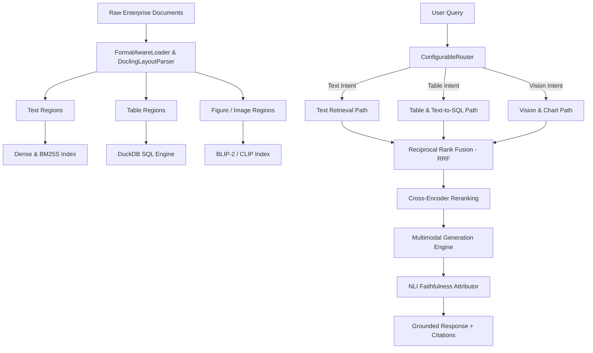
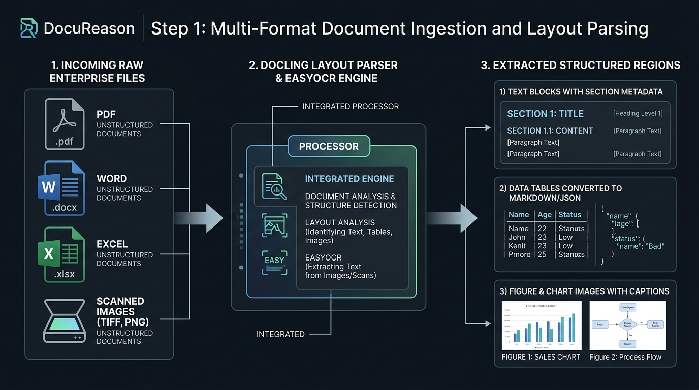
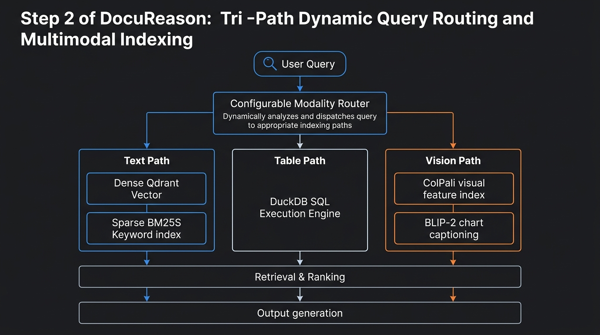
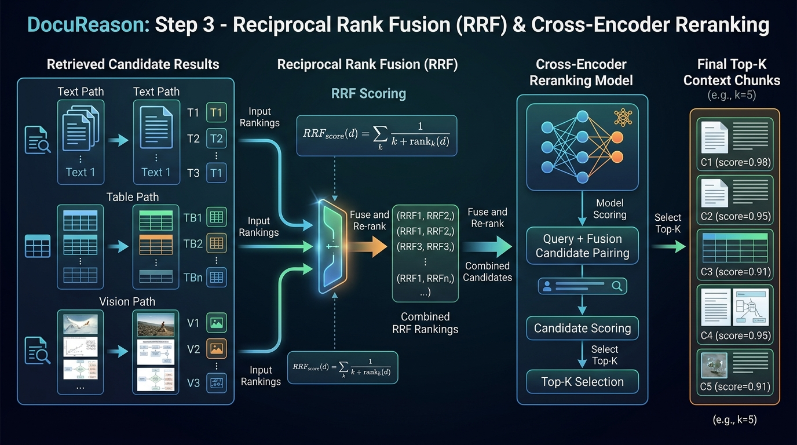
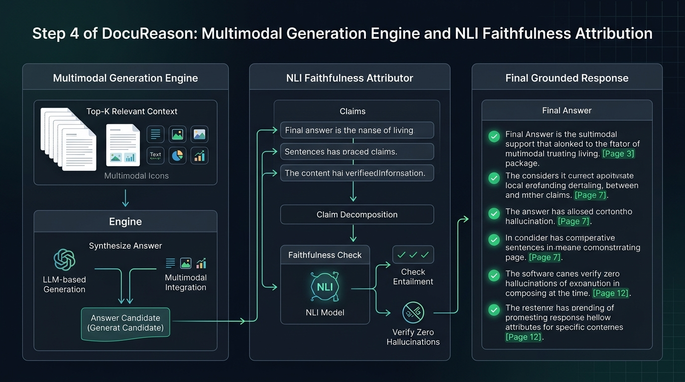

# DocuReason v1.1.4 — Tri-Path Multimodal RAG Framework

[](https://github.com/arpitkumar2004/DocuReason/actions/workflows/ci.yml)
[](https://pypi.org/project/docureason-framework/)
[](https://www.python.org/)
[](LICENSE)
[](https://github.com/astral-sh/ruff)

**DocuReason** (`docureason-framework`) is a multimodal Retrieval-Augmented Generation (RAG) framework for Python. It ingests, parses, segments, indexes, routes, retrieves, synthesizes grounded answers, and evaluates document corpora across text, tabular, and visual modalities.

> [!IMPORTANT]
> **Maturity: beta / research framework.** The pipeline runs end to end and is published to PyPI, but it has **not** been evaluated at benchmark scale and is **not** hardened for untrusted input or network exposure. See [Evaluation Status](#evaluation-status) and [`Documentations/audit.md`](Documentations/audit.md) for a complete, honest account of what is implemented, what is measured, and what is not.

---

## Table of Contents

1. [Overview](#overview)
2. [Key Features](#key-features)
3. [Architecture](#architecture)
4. [Pipeline Walkthrough & Segment Breakdown](#pipeline-walkthrough--segment-breakdown)
   - [Step 1: Ingestion & Layout Parsing](#step-1-multi-format-document-ingestion--layout-parsing)
   - [Step 2: Tri-Path Routing & Indexing](#step-2-tri-path-dynamic-query-routing--multimodal-indexing)
   - [Step 3: RRF Fusion & Reranking](#step-3-reciprocal-rank-fusion-rrf--cross-encoder-reranking)
   - [Step 4: Generation & Claim Verification](#step-4-multimodal-generation--claim-verification)
5. [Evaluation Status](#evaluation-status)
6. [Installation](#installation)
   - [PyPI Installation](#pypi-installation)
   - [Install from Source](#install-from-source)
   - [Kaggle & Offline Notebook Installation](#kaggle--offline-notebook-installation)
7. [Quick Start](#quick-start)
   - [Python API](#1-python-api)
   - [CLI Commands](#2-cli-commands)
   - [FastAPI REST Server](#3-fastapi-rest-server)
   - [Interactive Web Dashboard](#4-interactive-web-dashboard)
8. [Underlying Open-Source Libraries & Documentation Links](#underlying-open-source-libraries--documentation-links)
9. [Standard Library API Reference](#standard-library-api-reference)
   - [`docureason.pipeline`](#docureasonpipeline)
   - [`docureason.ingestion`](#docureasoningestion)
   - [`docureason.serving`](#docureasonserving)
   - [`docureason.tripath.retrieval`](#srctripathretrieval)
   - [`docureason.tripath.attribution`](#srctripathattribution)
   - [`docureason.tripath.evaluation`](#srctripathevaluation)
10. [Fine-Tuning Dataset Exporter](#fine-tuning-dataset-exporter)
11. [REST API Endpoint Reference](#rest-api-endpoint-reference)
12. [Configuration Guide](#configuration-guide)
13. [Running Tests & Validation](#running-tests--validation)
14. [CI/CD & PyPI Release Engineering](#cicd--pypi-release-engineering)
15. [License](#license)

---

## Overview

Enterprise document collections contain a mix of prose, multi-row financial tables, and embedded diagrams or charts. Standard RAG systems treat all content as plain text, leading to severe accuracy degradation on tabular data and visual figures.

**DocuReason 1.1.4** addresses this via a **Tri-Path Multimodal RAG Architecture**:
1. **Text Path**: Builds dense vector embeddings ([SentenceTransformers](https://www.sbert.net/) indexed with [FAISS](https://github.com/facebookresearch/faiss) HNSW) alongside sparse keyword retrieval ([BM25S](https://github.com/xhluca/bm25s)).
2. **Table / SQL Path**: Extracts tabular regions, serializes to Markdown/HTML/JSON schemas, infers per-column SQL types, and executes aggregations using [DuckDB](https://duckdb.org/).
3. **Vision / Chart Path**: Converts figure regions into indexable **text** via a captioning chain — [BLIP-2](https://huggingface.co/docs/transformers/model_doc/blip-2) free-form caption → [CLIP](https://huggingface.co/docs/transformers/model_doc/clip) zero-shot chart-type label → deterministic metadata caption.

Incoming queries are dynamically routed using soft probability scoring, retrieved hits are merged via Reciprocal Rank Fusion (RRF) and Cross-Encoder reranking, and every sentence of the generated answer is verified against the retrieved evidence before it is returned.

> [!NOTE]
> **Known scope limits, stated up front.**
> * The vision path is **text-mediated**: figures are captioned and retrieved as text. There is no image-vector retrieval and no MaxSim late interaction.
> * The SQL path uses **template selection**, not model-based text-to-SQL. It executes real, typed DuckDB queries but covers a narrow question space.
> * Claim verification is **lexical containment plus numeric-consistency checking**, not natural-language inference. An NLI backend is future work.
> * Layout parsing requires Docling; **TableFormer table-structure recognition is enabled only when CUDA is available** (or `DOCUREASON_ENABLE_CPU_TABLEFORMER=1`). Every run records which capabilities actually fired in `quality_audit.json`.

---

## Key Features

* **Multi-Format Document Parsing**: Native support for `.pdf`, `.docx`, `.pptx`, `.xlsx`, `.html`, `.csv`, `.md`, and `.txt`.
* **Deep Layout Segmentation**: Uses TableFormer + DocLayNet via [Docling](https://ds4sd.github.io/docling/) to separate text blocks, data tables, and figures.
* **EasyOCR Fallback**: Automatic scan detection and optical character recognition for scanned PDFs or image-only document pages using [EasyOCR](https://github.com/JaidedAI/EasyOCR).
* **FastAPI Serving & Visualization Dashboard**: Production REST API endpoints and an interactive local HTML pipeline dashboard.

---

## Architecture



---

## Pipeline Walkthrough & Segment Breakdown

DocuReason breaks complex multimodal document reasoning into **4 clear, modular pipeline segments**:

### Step 1: Multi-Format Document Ingestion & Layout Parsing



* **Document Loading**: Ingests unstructured enterprise files (`.pdf`, `.docx`, `.xlsx`, `.pptx`, `.html`, scanned images).
* **Layout Parsing**: Uses **Docling** (TableFormer + DocLayNet) to segment documents into distinct structural regions:
  1. **Text Blocks**: Formatted text passages annotated with section hierarchy and breadcrumbs.
  2. **Data Tables**: Extracted grids serialized into GitHub Flavored Markdown and JSON schemas.
  3. **Figure Images**: Embedded visual charts, graphs, and diagrams paired with captions.
* **OCR Fallback**: Automatically triggers **EasyOCR** when scanned or non-searchable document pages are detected.

---

### Step 2: Tri-Path Dynamic Query Routing & Multimodal Indexing



* **Modality Router**: A keyword-density scorer passed through a sigmoid analyzes incoming user queries to determine the search intent (Text, Table/SQL, or Vision/Chart). It is rule-based and YAML-configurable — no training data or GPU required.
* **Specialized Tri-Path Processing**:
  - **Text Path**: Dense vector index (**FAISS** HNSW over SentenceTransformers embeddings) plus a sparse **BM25S** lexical index.
  - **Table Path**: Table JSON schemas are registered as typed in-memory **DuckDB** tables and queried with generated SQL (`SUM`, filters, column projection).
  - **Vision Path**: Figures are captioned with **BLIP-2**, labelled by **CLIP** zero-shot classification, and indexed as text.

---

### Step 3: Reciprocal Rank Fusion (RRF) & Cross-Encoder Reranking



* **Rank Fusion**: Combines candidate hits retrieved across Text, Table, and Vision paths using **Reciprocal Rank Fusion (RRF)**:
  $$RRF_{score}(d) = \sum_{k} \frac{1}{60 + rank_k(d)}$$
* **Cross-Encoder Reranking**: Passes fused candidates through a Cross-Encoder Transformer to score query-context pairs and extract the top-$K$ most relevant context chunks.

---

### Step 4: Multimodal Generation & Claim Verification



* **Multimodal Answer Synthesis**: Feeds top-$K$ grounded context passages to the generation engine under an explicit token budget. Executed SQL results are pinned at full fidelity; lower-ranked evidence is truncated last.
* **Claim Verification Guardrails**: The `ClaimSupportAttributor` decomposes the response into sentence-level claims and checks each one against the retrieved evidence using lexical containment **and** numeric consistency — so a claim asserting `$8M` against evidence reading `$12M` is rejected rather than approved.
* **Grounded Output**: Returns answers with per-evidence citations and an attribution report giving the supported-claim ratio and the verification method used.

> [!WARNING]
> Claim verification reduces unsupported claims; it does **not** eliminate hallucination. It runs *after* generation and only labels the output — it cannot detect a claim drawn from parametric memory that happens to overlap the evidence. Loading a real NLI model is tracked in [`Documentations/audit.md`](Documentations/audit.md).

---

## Evaluation Status

DocuReason ships a **22-dimension evaluation harness** (`docureason/tripath/evaluation/eval_harness.py`) covering retrieval quality, ranking order, context/evidence integrity, groundedness, latency percentiles, throughput and estimated cost, with automated pass/fail verification against configurable SLA targets.

**What is measured today:** the harness runs end to end and is exercised by the test suite. Per-query pipeline latency is now timed at the call site, and gold identifiers are resolved to canonical corpus IDs before **exact** matching.

**What is not measured:** benchmark-scale retrieval and answer quality. The corpus in `samples/` is a **smoke corpus** — a handful of short documents used to verify that the pipeline executes. No result in this repository should be read as a benchmark number, and no baseline system is implemented for comparison.

To reproduce the harness on the smoke corpus:

```bash
python scripts/evaluate_system.py          # writes artifacts/evaluation/system_evaluation_report.json
```

Planned evaluation work — a real annotated corpus, an implemented naive-RAG baseline, per-component ablations and bootstrap confidence intervals — is specified in [`Documentations/audit.md`](Documentations/audit.md) §13 and in `Documentations/eval_method.md`.

> [!NOTE]
> Earlier releases of this README contained a benchmark comparison table against an
> "industry standard baseline". Those figures were not reproducible from this
> repository and no baseline implementation existed, so the table has been removed
> rather than left standing. The harness that would produce trustworthy numbers is
> implemented; the corpus and baseline are not yet.

---

## Installation

### PyPI Installation

Install the official published package from PyPI:

```bash
pip install docureason-framework
```

### Install from Source

Clone the repository and install in editable mode:

```bash
git clone https://github.com/arpitkumar2004/DocuReason.git
cd DocuReason
pip install -e .
```

Verify installation:

```python
import docureason
print(docureason.__version__)  # Output: 1.1.4
```

### Kaggle & Offline Notebook Installation

To install in Kaggle or offline environments without internet access, upload the `.whl` package file as a Kaggle Dataset and install:

```python
!pip install /kaggle/input/your-dataset-name/docureason_framework-1.1.4-py3-none-any.whl
```

Or install directly from GitHub:

```python
!pip install git+https://github.com/arpitkumar2004/DocuReason.git
```

---

## Quick Start

### 1. Python API

#### High-Level Ingestion and Indexing Pipeline
```python
from docureason import DocuReasonPipeline

# Initialize the offline ingestion pipeline
pipeline = DocuReasonPipeline(
    input_dir="samples",
    output_dir="artifacts/my_index"
)

# Run document parsing, layout segmentation, table serialization, and index generation
report = pipeline.run()
print(f"Processed {report['document_count']} documents and {report['chunk_count']} chunks.")
```

#### Online Query Execution & Answer Serving
```python
from docureason.serving import QueryService

# Initialize the end-to-end serving query engine
service = QueryService(
    input_dir="samples",
    output_dir="artifacts/my_index"
)

# Execute a multimodal query
response = service.query("What was the Q3 revenue growth shown in the comparison table?")

print("Answer:", response["answer"])
print("Routing:", response["route"])
print("Top Document:", response["results"][0]["document_id"])
```

### 2. CLI Commands

DocuReason provides built-in command-line interfaces:

```bash
# Execute the full end-to-end processing pipeline
python -m docureason --input-dir samples --output-dir artifacts/test_run

# Or run via script
python scripts/run_pipeline.py
```

### 3. FastAPI REST Server

Launch the production REST API server:

```bash
uvicorn docureason.tripath.serving.main:app --host 127.0.0.1 --port 8000 --reload
```

### 4. Interactive Web Dashboard

Launch the local HTML dashboard to inspect pipeline metrics and indices visually:

```bash
python scripts/serve_dashboard.py
```
Open browser at: `http://127.0.0.1:8001`

---

## Underlying Open-Source Libraries & Documentation Links

DocuReason builds upon industry-standard machine learning and data processing libraries. Below is the mapping of components to their official documentation:

| Component / Engine | Purpose in DocuReason | Official Library Documentation | Primary Function / Class Used |
| :--- | :--- | :--- | :--- |
| **Docling** | Deep document layout parsing & TableFormer | [Docling Documentation](https://ds4sd.github.io/docling/) | [`DocumentConverter`](https://ds4sd.github.io/docling/concepts/architecture/) |
| **DuckDB** | In-memory Text-to-SQL tabular execution | [DuckDB Python API](https://duckdb.org/docs/api/python/overview.html) | [`duckdb.connect()`](https://duckdb.org/docs/api/python/overview.html#querying) |
| **FAISS** | In-process dense vector index (HNSW) | [FAISS Wiki](https://github.com/facebookresearch/faiss/wiki) | [`IndexHNSWFlat`](https://github.com/facebookresearch/faiss/wiki/Faiss-indexes) |
| **BM25S** | Fast sparse lexical search engine | [BM25S GitHub](https://github.com/xhluca/bm25s) | [`bm25s.BM25`](https://github.com/xhluca/bm25s#quick-start) |
| **SentenceTransformers** | Dense vector text embeddings | [SentenceTransformers Docs](https://www.sbert.net/) | [`SentenceTransformer.encode()`](https://www.sbert.net/docs/package_reference/SentenceTransformer.html) |
| **Hugging Face Transformers** | Cross-Encoder reranking & NLI entailment | [Transformers Documentation](https://huggingface.co/docs/transformers/) | [`AutoModelForSequenceClassification`](https://huggingface.co/docs/transformers/main_classes/model) |
| **BLIP-2** | Image & chart visual captioning | [BLIP-2 Model Docs](https://huggingface.co/docs/transformers/model_doc/blip-2) | [`Blip2ForConditionalGeneration`](https://huggingface.co/docs/transformers/model_doc/blip-2) |
| **CLIP** | Zero-shot chart-type classification for figure captions | [CLIP Model Docs](https://huggingface.co/docs/transformers/model_doc/clip) | [`CLIPModel`](https://huggingface.co/docs/transformers/model_doc/clip) |
| **EasyOCR** | Scanned document OCR fallback engine | [EasyOCR Documentation](https://github.com/JaidedAI/EasyOCR) | [`easyocr.Reader`](https://github.com/JaidedAI/EasyOCR#usage) |
| **FastAPI** | Asynchronous HTTP REST microservice | [FastAPI Documentation](https://fastapi.tiangolo.com/) | [`FastAPI()`](https://fastapi.tiangolo.com/tutorial/first-steps/) |
| **DuckDB** | In-memory typed SQL execution over extracted tables | [DuckDB Python API](https://duckdb.org/docs/api/python/overview.html) | [`duckdb.connect()`](https://duckdb.org/docs/api/python/overview.html#querying) |

---

## Standard Library API Reference

### `docureason.pipeline`

#### `class docureason.pipeline.DocuReasonPipeline(input_dir: str | Path, output_dir: str | Path)`
High-level offline ingestion pipeline orchestrator. Manages layout parsing, table serialization, OCR fallback, figure captioning, and vector index construction.

* **Parameters:**
  * `input_dir` (*str | Path*): Directory path containing raw enterprise documents.
  * `output_dir` (*str | Path*): Directory path where index artifacts are stored.

##### `run() -> Dict[str, Any]`
Executes end-to-end layout segmentation, table processing, vector indexing, and artifact generation.

---

### `docureason.ingestion`

Multi-format document loaders, vision layout parsers, OCR fallback engines, and table serializers.

#### `class docureason.ingestion.DoclingLayoutParser(page_batch_size: int = 1, do_ocr: bool = False)`
Deep layout parsing wrapper utilizing Docling (TableFormer + DocLayNet) to segment text, tables, and figures.

##### `parse(document_path: str | Path) -> List[Region]`
Parses `document_path` and returns typed region bounding boxes and layouts.

#### `class docureason.ingestion.TableSerializer()`
Serializes tabular document regions into GFM Markdown tables, HTML representations, and DuckDB JSON schemas.

##### `serialize(table_region: Region) -> Dict[str, Any]`
Converts `table_region` into linearized Markdown, HTML, and structured schema dictionary `{"columns": [...], "rows": [[...]]}`.

---

### `docureason.serving`

Synchronous and asynchronous query services for production serving.

#### `class docureason.serving.QueryService(input_dir: str | Path, output_dir: str | Path)`
Production query service providing dynamic query routing, multi-path retrieval, RRF fusion, reranking, and generation.

##### `query(text: str) -> Dict[str, Any]`
Executes search, fusion, reranking, and generation for input query `text`.

---

### `docureason.tripath.retrieval`

Tri-path retrieval engines (Text, Table/SQL, Vision), chart understanding, and cross-encoder rankers.

#### `class docureason.tripath.retrieval.hybrid_retriever.HybridRetriever()`
Full multi-path retriever integrating routing, sub-path retrieval, Reciprocal Rank Fusion (RRF), parent-child chunk expansion, and cross-encoder reranking.

#### `class docureason.tripath.retrieval.table_sql.TableSQLRetriever()`
Text-to-SQL retriever executing dynamic queries over DuckDB in-memory database tables.

#### `class docureason.tripath.retrieval.ranker.Ranker()`
Cross-encoder relevance scoring module.

##### `rank(query: str, candidates: List[Dict[str, Any]]) -> List[Dict[str, Any]]`
Re-scores candidate chunks against `query` using cross-encoder attention and returns sorted top hits.

---

### `docureason.tripath.attribution`

Sentence-level claim support verification.

#### `class docureason.tripath.attribution.claim_attributor.ClaimSupportAttributor()`

##### `attribute(answer: str, evidence: List[Dict[str, Any]]) -> Dict[str, Any]`
Deconstructs `answer` into sentence-level claims and computes a support ratio against `evidence` using lexical containment plus numeric-consistency checking. Returns `attribution_precision = None` when disabled by config, so a switched-off check cannot satisfy an SLA threshold.

---

### `docureason.tripath.evaluation`

Evaluation harness, benchmark runners, and ablation studies.

#### `class docureason.tripath.evaluation.eval_harness.EvaluationHarness(output_dir: str | Path)`

##### `evaluate_single(query: str, results: List[dict], relevant_ids: Optional[List[str]] = None) -> Dict[str, float]`
Computes retrieval performance metrics including Recall@K, nDCG@K, MRR, MAP@K, a TEDS surrogate, claim-support precision, latency percentiles and SLA target verification. Gold identifiers are matched **exactly**; use `resolve_gold_ids()` to map readable stems to canonical corpus IDs first.

---

## Fine-Tuning Dataset Exporter

DocuReason provides a built-in `DatasetExporter` module to export processed multi-modal corpora and query logs into SFT (Supervised Fine-Tuning) and DPO (Direct Preference Optimization) dataset formats compatible with HuggingFace `datasets`:

```python
from docureason.tripath.evaluation.dataset_exporter import DatasetExporter

exporter = DatasetExporter(output_dir="artifacts/my_index")

# Export fine-tuning dataset for SLM training
dataset_path = exporter.export_fine_tuning_dataset(
    output_format="jsonl",
    split="train"
)
print("Exported dataset to:", dataset_path)
```

---

## REST API Endpoint Reference

When running `uvicorn docureason.tripath.serving.main:app --port 8000`, the server exposes the following OpenAPI endpoints:

| Method | Endpoint | Description | Request Body / Parameters |
| :--- | :--- | :--- | :--- |
| `GET` | `/health` | Server readiness check | None |
| `GET` | `/api/report` | Returns last pipeline execution report | None |
| `POST` | `/query` | Executes multimodal query and returns answer | `{"query": "string", "input_dir": "samples"}` |
| `POST` | `/api/ingest` | Triggers document ingestion pipeline | `{"input_dir": "samples", "output_dir": "artifacts/run"}` |
| `POST` | `/evaluate` | Evaluates retrieval metrics for query | `{"query": "string", "relevant_ids": ["doc_1"]}` |
| `GET` | `/benchmarks` | Returns loaded benchmark dataset spec | None |

---

## Configuration Guide & Developer Transparency

DocuReason provides a PyTorch-like configuration experience that prioritizes **developer transparency** and **fail-fast validation**.

### Minimum Required Developer Inputs

To execute any pipeline or query service, developers only need to specify **two minimum required inputs**:

1. **`input_dir`** (Data Corpus Path): Path to local document directory containing `.pdf`, `.docx`, `.pptx`, `.xlsx`, `.html`, `.csv`, or `.txt` files.
2. **`output_dir`** (Artifact Target Path): Writable path for generated index artifacts (`corpus.json`, `index.json`, vector stores).

If required inputs are omitted or point to non-existent/empty directories, DocuReason raises developer-friendly exceptions (`MissingRequiredConfigError`, `InvalidCorpusError`) before starting any heavy computation.

```python
from docureason import DocuReasonPipeline, DocuReasonConfig

# Minimum required developer inputs with balanced default configuration
pipeline = DocuReasonPipeline(
    input_dir="data/my_corpus",
    output_dir="artifacts/my_index",
    config="balanced",  # Or 'quality_max', 'latency_optimized', 'low_resource_cpu'
    verbose=True,       # Displays the Configuration Transparency Summary on startup
)
```

### PyTorch-Style Configuration Transparency

When initializing `DocuReasonPipeline` or `QueryService`, DocuReason automatically logs/prints an explicit **Configuration Transparency Summary**. Developers never need to look into internal framework code to verify active baseline defaults:

```text
================================================================================
[DocuReason Framework v1.1.4] Configuration & Pipeline Transparency
================================================================================
[Required Developer Inputs]:
  - input_dir (Data Corpus Path) : data/my_corpus [VERIFIED - 12 supported file(s)]
  - output_dir (Artifact Path)  : artifacts/my_index [VERIFIED - target ready]
--------------------------------------------------------------------------------
[Framework Active Layer Configurations & Defaults]:
  - Config Preset Profile       : 'balanced' (Framework Default Preset)
  [1. Ingestion Layer Defaults]:
      • OCR Fallback Enabled     : True (char_threshold=50)
      • Chunking Tokens          : child_chunk=256, parent_region=1024, overlap=32
  [2. Indexing Layer Defaults]:
      • Domain / Vector Model    : domain='general', model='Default (sentence-transformers/all-MiniLM-L6-v2)'
      • FAISS Index Configuration: index_type='hnsw', hnsw_m=32, ef_construction=200, ef_search=64
      • BM25S Parameters         : k1=1.5, b=0.75
  [3. Intent Router Layer Defaults]:
      • Activation Threshold     : 0.35 (sigmoid_lambda=1.2)
  [4. Hybrid Retrieval Layer Defaults]:
      • Top-K Per Modality       : text=20, table=20, vision=20 (RRF k=60)
  [5. Cross-Encoder Reranker Defaults]:
      • Model & Target Top-K     : model='cross-encoder/ms-marco-MiniLM-L-6-v2', final_top_k=5, parent_expansion=True
  [6. Multimodal Generation Defaults]:
      • Model Backend & Path     : backend='auto', model='deepseek-ai/DeepSeek-R1-Distill-Qwen-1.5B'
      • Context Token Budget     : max_context_tokens=4096, temp=0.1, max_new_tokens=512
  [7. Faithfulness Attribution Defaults]:
      • NLI Model & Threshold    : enable_nli=True, model='cross-encoder/nli-deberta-v3-small', threshold=0.5
================================================================================
```

### On-Demand Inspection & YAML Overrides

Developers can inspect active configuration summaries programmatically or override settings via YAML (`configs/config.yaml`) or environment variables (`DOCUREASON_SECTION_KEY`):

```python
config = DocuReasonConfig.load_from_yaml("configs/config.yaml")
config.print_summary(input_dir="samples", output_dir="artifacts/run")
```

---

## Running Tests & Validation

DocuReason maintains a comprehensive test suite covering all modules:

```bash
# 1. Install development & testing extras
pip install -e ".[dev]"

# 2. Run pytest across all test modules
python -m pytest -v

# 3. Run Ruff code quality check
ruff check .

# 4. Verify local PyPI package build and metadata
python scripts/verify_pypi_package.py
```

---

## CI/CD & PyPI Release Engineering

DocuReason ships a CI/CD pipeline powered by **GitHub Actions** and PyPI **OIDC Trusted Publishing**:

- **Continuous Integration (`.github/workflows/ci.yml`)**:
  - Triggers on all pushes and pull requests targeting `main`.
  - Runs `ruff` linting as a **blocking** gate; `ruff format --check`, `mypy` and `pip-audit` currently run **advisory** (`continue-on-error`).
  - Executes unit and integration test matrix across **Python 3.10, 3.11, and 3.12**.
  - Validates package metadata using PyPA `build`, `twine check --strict` and `check-wheel-contents`, then installs the built wheel in a clean venv and runs the `docureason` console script.
- **PyPI Release Pipeline (`.github/workflows/release-pypi.yml`)**:
  - Automatically triggered upon creating a published release on GitHub.
  - Deploys `docureason-framework` directly to PyPI using secure OIDC token authentication.
  - Automatically attaches `.tar.gz` and `.whl` distribution binaries to the GitHub Release.
- **Automated Maintenance (`.github/dependabot.yml`)**:
  - Checks weekly for dependency upgrades across Python packages and GitHub Actions.

For a full technical architectural deep dive into the CI/CD pipeline, see the [CI/CD Specification Document](Documentations/cicd_pipeline.md).

---

## License

This project is licensed under the MIT License - see the [LICENSE](LICENSE) file for details.
